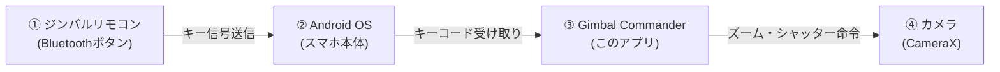

# 初心者のための Gimbal Commander 解説書

このドキュメントは、Androidアプリ開発が初めての方に向けて、今回作成したアプリの**仕組み**と**ファイル構成**をわかりやすく解説したものです。

---

## 1. このアプリがやろうとしていること（仕組み）

スマホ用ジンバルのリモコンを使って、Xperiaのカメラを操作する仕組みは、以下の3つのステップで動いています。



### ① ジンバルのリモコンは何者？
ジンバルのリモコンは、Bluetoothでスマホに繋ぐと、基本的には**「ワイヤレスキーボード」**や**「ゲームのコントローラー」**と同じ仲間（HIDデバイス）として認識されます。
- シャッターボタンを押すと、実はキーボードの「音量アップキー」や「Enterキー」と同じような信号（キーコード）がスマホに送られています。

### ② アプリがキー信号をキャッチする
スマホに送られてきたキー信号を、アプリが「どのボタンが押されたか？」「離されたか？」を監視・解析します。
- **通常のキー（ボタン）**: `KeyEvent`（ボタンの種類、押した/離した）
- **ジョイスティック・ダイヤル**: `MotionEvent`（上下左右の傾き具合や回転量）

### ③ カメラを動かす
キャッチしたボタンの種類（例: 音量上ボタン）に応じて、「カメラのシャッターを切る」「ズームを+0.2倍する」といった命令をカメラに送ります。

---

## 2. Androidアプリの基本パーツと今回の役割

Androidアプリは、役割分担された複数のパーツ（ファイル）が集まって動いています。身近な例え（レストラン）と一緒に見てみましょう。

| Androidの用語 | レストランに例えると | このアプリでの役割 | 今回の主なファイル |
| :--- | :--- | :--- | :--- |
| **Activity (画面)** | 店頭・客席 | アプリの土台。OSからのキー入力を一番最初に受け取る窓口 | `MainActivity.kt` |
| **Compose (UI)** | メニュー表・インテリア | 画面の見た目（ボタン、文字、ログ表示など）を描く | `KeyTesterScreen.kt`<br>`CameraScreen.kt` |
| **ViewModel (状態管理)** | 注文管理システム / 店長 | 押されたキーの履歴や、どのボタンを何に割り当てたかを覚えておく | `KeyCaptureViewModel.kt` |
| **Manager (機能制御)** | 厨房（料理人） | 実際にカメラを起動して撮影したりズームする実務を行う | `CameraXManager.kt` |
| **Service (バックグラウンド)** | 出前・裏方スタッフ | アプリの画面を閉じていても、裏でキー入力を監視する（将来用） | `GimbalAccessibilityService.kt` |
| **Manifest (マニフェスト)** | 営業許可証・届出書 | 「カメラを使います」「Bluetoothを使います」とOSに申請する名簿 | `AndroidManifest.xml` |

---

## 3. 今回作成したファイル一覧と中身の解説

プロジェクト内のファイルがそれぞれ何をしているのかをまとめました。

```
gimbal-commander/
├── docs/                                  # 初学者向けドキュメント（このファイル）
├── GEMINI.md                              # agy（AI）にプロジェクトのルールを教える説明書
├── .agents/skills/gimbal-key-capture/     # agyが使うジンバル開発用手順書
│   └── SKILL.md
│
├── app/src/main/
│   ├── AndroidManifest.xml                # アプリの設計図（必要な権限の申告）
│   ├── res/                               # デザインやテキスト（設定ファイルなど）
│   │   ├── values/strings.xml             # アプリ名などの固定テキスト
│   │   └── xml/accessibility_service_config.xml # 裏でキーを監視するための設定
│   │
│   └── java/com/example/gimbalcommander/  # プログラム本体（Kotlin）
│       ├── MainActivity.kt                # アプリ起動時に動くメインの窓口
│       ├── model/CapturedInputEvent.kt    # 「キー情報」や「カメラ動作」のデータ形式定義
│       ├── viewmodel/KeyCaptureViewModel.kt # キー情報の記録・マッピング管理
│       ├── camera/CameraXManager.kt       # カメラのズームや撮影を動かす専門クラス
│       ├── service/GimbalAccessibilityService.kt # バックグラウンド監視用
│       └── ui/
│           ├── theme/Theme.kt             # アプリの配色設定
│           └── screens/
│               ├── KeyTesterScreen.kt     # リモコンのボタンを押して調べる画面
│               └── CameraScreen.kt        # カメラを実際に動かして試す画面
│
├── build.gradle.kts                       # ビルド設定（プロジェクト全体）
├── settings.gradle.kts                    # 読み込むモジュール設定
└── gradle/libs.versions.toml              # ライブラリのバージョン一覧
```

### 主要ファイルの詳しい中身

#### 1. `MainActivity.kt`（アプリの入り口）
- ユーザーがアプリアイコンをタップすると、最初にこのファイルが動きます。
- ここで `dispatchKeyEvent`（キー入力をキャッチする関数）を使って、ジンバルのリモコンが押された瞬間のイベントを受け取ります。

#### 2. `KeyTesterScreen.kt`（キー解析画面）
- リモコンのボタンを押したときに、画面に**「今、どのキーコードが押されたか」**をリアルタイム表示します。
- 「このボタンをシャッターにする」といった割り当てを選ぶドロップダウンもついています。

#### 3. `CameraScreen.kt` & `CameraXManager.kt`（カメラ画面）
- Android公式のカメラライブラリ「CameraX」を使って、スマホのカメラ映像を画面に映します。
- 割り当てられたボタンが押されたら、シャッターを切ったりズーム倍率を変更します。

#### 4. `GimbalAccessibilityService.kt`（裏方サービス）
- Androidの「ユーザー補助機能」を利用して、アプリを閉じてXperia純正カメラ（Photography Proなど）を起動している時でもリモコンのボタンを検知するための土台です。

---

## 4. agy（Antigravity）用ファイルとは？

今回配置した `GEMINI.md` や `.agents/skills/` は、**AIアシスタント（agy）専用のカンペ・説明書**です。

- **`GEMINI.md`**:
  - AIに対して「このプロジェクトはAndroidのジンバルリモコン連携アプリで、MVVM構成で、CameraXを使うよ」という大前提を伝えています。これがあることで、AIが文脈を外れた回答をするのを防ぎます。
- **`.agents/skills/gimbal-key-capture/SKILL.md`**:
  - 「ジンバルリモコンのボタンはどうやって調べるか」「ズームはどうプログラムするか」といった専門知識をまとめたAI用の参考書です。

---

## 5. 今後の進め方について

コードはひととおり配置してありますが、**決して一度にすべてを理解する必要はありません！**

まずは以下のステップで、1つずつ確認しながら進めていきましょう。

1. **ステップ1**: 手持ちのジンバルリモコンをXperiaにBluetooth接続してみる
2. **ステップ2**: アプリを実行し、「キー解析画面」でボタンを押してキーコードが表示されるのを確認する
3. **ステップ3**: どのボタンにシャッターやズームを割り当てるか決める
4. **ステップ4**: カメラを動かしてみる / Xperia標準カメラアプリとの連携を試す

分からない用語や「ここはどう動いているの？」という疑問があれば、いつでも気軽に聞いてください！

